# X0X Live for M-VAVE FM-1

An alternative FM-1 firmware for making acid music as you play. Discover a
bassline, keep an idea you like, develop it, bring in drums and direct the next
break or drop. Two independent 303s, 909 and 808 drums, hands-on sound controls
and performance effects share one LIVE interface.

**Current version: 1.2.1-live11 · experimental.** Hardware validation is pending.

**[Play in your browser](https://copych.github.io/fm1-x0x/emu/)** ·
**[Install on FM-1](https://copych.github.io/fm1-x0x/install/)** ·
**[Full controls guide](https://copych.github.io/fm1-x0x/performance/)** ·
**[Download firmware](https://copych.github.io/fm1-x0x/firmware/x0x-1.2.1-live11.fwsc)**

## What it does

- **Two acid voices.** Independent 303 patches with cutoff, resonance, envelope,
  decay, accent, waveform and drive, plus pan and effect sends.
- **Generate, keep, develop.** Discover phrases, LIKE an idea, explore variations
  and RETURN to it. Musical undo keeps your later sound changes.
- **Generative drums.** 909 and 808 kits with eleven instruments each. Weird and
  Full move a groove from sparse and straight to busy and adventurous. Kick and
  hats start audible; bring in other instruments with the keys.
- **Direct the performance.** Queue INTRO, GROOVE, BUILD, BREAK, BRIDGE, DROP or
  OUTRO. Extend or shorten the current segment by a bar. The Director prototype
  can prepare a complementary 303 B phrase and coordinated drums around A.
- **Play the mix.** Direct part and drum mutes, solo, linked selection and mix
  restoration. Four controls always follow the physical K1–K4 order.
- **Shape movement and space.** Bar-aligned modulation, growing and falling
  ramps; delay and reverb controls; momentary filters, pump, drive, tape stop,
  sixteenth-note chopper, captured audio repeats and live snare rolls.

## Screens

These are screen captures from the matching emulator. Each screen is 240 × 240;
labels stay large, controls follow the knobs from left to right, and values are
right-aligned. Pan uses horizontal sliders.

| Sound | Mixer | Pan |
| --- | --- | --- |
| 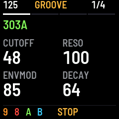 | 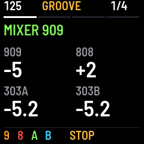 | 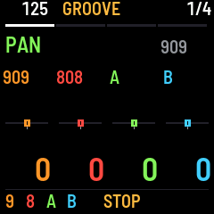 |

| Automation | Director | Drum instrument |
| --- | --- | --- |
| 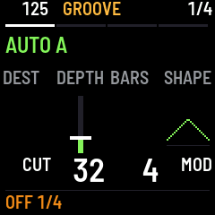 | 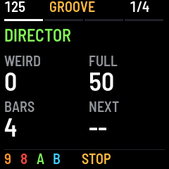 | 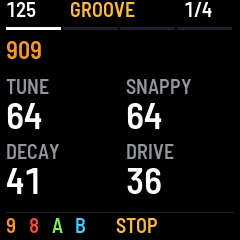 |

| Momentary FX | Delay | Reverb |
| --- | --- | --- |
| 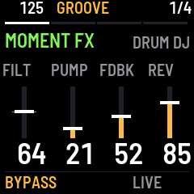 | 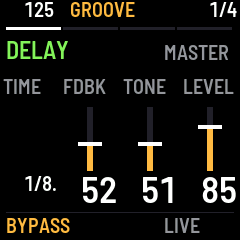 | 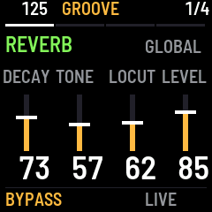 |

| 303 extra controls | Compressor | Snare roll |
| --- | --- | --- |
| 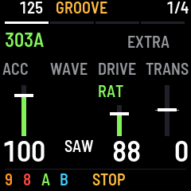 | 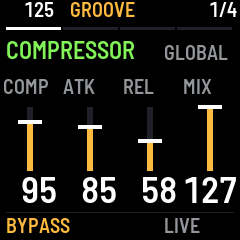 | 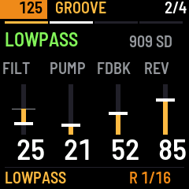 |

## Install

1. **Back up first.** For Sloop, use the [Sloop editor](https://isod89.github.io/sloop-fm1/webapp/editor/).
   The [X0X backup page](https://copych.github.io/fm1-x0x/backup/) handles X0X
   projects only. Keep your previous firmware and its recovery instructions.
2. Connect the FM-1 with a USB data cable. Close other MIDI apps and editor tabs.
3. Open the [web installer](https://copych.github.io/fm1-x0x/install/) in desktop
   Chrome or Edge and allow MIDI / SysEx access when asked.
4. Follow the connection and installation instructions. Keep USB connected
   until the update completes and the instrument restarts.
5. Start playing on LIVE.

Direct switching from every alternative firmware, including Sloop, is not yet
verified. If the instrument will not start, see the
[recovery instructions](https://copych.github.io/fm1-x0x/manual/#recovering-an-fm-1-that-won-t-start).

## Your first groove

1. Start with **303 A** selected. Press **OCT+** to generate a phrase, then **PLAY**.
2. Turn **K1–K4** for cutoff, resonance, envelope modulation and decay.
3. Tap **ARP** for Director, then **ARP again** to request a related B phrase and
   drum groove. During playback it arrives at the next segment boundary.
4. Press **SEQ** to LIKE selected musical material. Use **OCT−** to develop it;
   **GLO** returns to the capture. **REC** undoes the last musical change.
5. Tap **LFO** for Mixer. Black keys mute/unmute parts; white keys mute/unmute
   individual drums. **PRESETS** switches the focused 909/808 kit.
6. Tap **FX**, then hold white keys for momentary effects. Release to return.

## Find your controls

| Button | What you get |
| --- | --- |
| **EDIT** | Selected instrument's sound; tap again for extra controls |
| **LFO** | Mixer; repeated taps cycle Level, Pan, Reverb send, Delay send |
| **FX** | Momentary, Delay, Reverb, Compressor and Comp Detail; repeated taps cycle them |
| **ENV** | Automation: destination, depth, bars and shape |
| **ARP** | Director: Weird, Full, segment length and next section |
| **HOME** | Return to LIVE sound controls |
| **SAVE** | Save the current project |

SELECT also cycles views inside Mixer and FX. **HOME + SELECT** changes tempo
there; SELECT elsewhere in LIVE changes tempo directly.

The first four **black keys** select **909 / 808 / 303 A / 303 B** outside Mixer;
hold SEL to select several. On a drum sound screen, **white keys** select the
instrument named in the heading. In Mixer, those keys operate mutes instead.
Tap the selected black key again to toggle its native/extra sound controls,
just like EDIT. The 303 extra controls are Accent, Wave, Drive and Transpose
(−24..+24 semitones on the current pattern). DRIVE 0 is off; 1–63 spans SOFT;
64–127 spans RAT, with gentle 1:1 amounts at positions 64–68.
Hold **REC + a musical key** for solo. **HOME + SEL** restores the captured mix.

**Global FX controls:** Delay has time division, feedback, tone and return level.
Reverb has decay, tone, low cut and return level. White keys keep their momentary
FX gestures in every FX view. Compressor has amount, attack, release and dry/wet
mix; Comp Detail has threshold, ratio, makeup and kick pump. The amount macro
changes threshold, ratio and makeup together; use Comp Detail afterward for
individual adjustments.

**Snare rolls:** hold white keys **10 / 11 / 12** in FX for **1/8 / 1/16 / 1/32**
rolls on the last selected drum kit. Hold a roll while turning K1 DJ filter or
holding a filter key. Releasing one does not stop the other. The DJ filter
affects **909 and 808 drums**, including new FX sends; the 303s and existing
delay/reverb tails stay outside it.

**Beat-aligned effects:** effect presses wait for the next sixteenth-note event.
Release before it starts to cancel. Chopper passes attacks and silences tails,
with its open edge locked to each sixteenth. Rolls retrigger the current snare
sound without editing the pattern; whole-kit mutes still win. Roll gestures
require the internal clock and stop when transport stops.

**Automation:** K2 sets depth from 0 to 127. White keys offer three depths each
of modulation, growing and falling ramps; cycles are 1, 2, 4 or 8 bars. A four-bar
ramp engaged in bar 3 joins the current phase and resets after bar 4. Turn the
sound knob to take over manually.

For detailed editing, hold **SEL + SEQ**; for settings, **SEL + GLO**. Press
**HOME** to come back. The [controls guide](https://copych.github.io/fm1-x0x/performance/)
covers every key gesture, section control and automation preset.

## Saving and current limits

**SAVE** preserves the project. **LIKE** captures patterns and generator settings,
not synth patches or the mix. Captures, musical undo, manual mutes, section
position and automation are temporary performance state and do not survive a restart.
Named scene presets and a persistent favorites library are not available yet.

Tape stop, chopper, repeats, drive and pump act on the master mix; the DJ filter
acts on the drums. Momentary starts require playback and the normal 909 16-step
sixteenth-note reference. Repeat history is
about 371 ms, so longer repeats are capped. Maximum delay is about 1.26 seconds.
Breakbeat playback is disabled in this version. The Director is an early
prototype; the firmware has not yet been validated on physical FM-1 hardware.

## Credits

Based on [X0X by Charles Vestal](https://github.com/charlesvestal/fm1-x0x) and
[Felucca by Leo Kuroshita / Hügelton Instruments](https://github.com/hugelton/Felucca).
The acid voices use Open303; drums derive from
[9W9](https://github.com/athousanddetails/schwung-9W9) and
[8W8](https://github.com/athousanddetails/schwung-8W8); generation derives from
[schwung-tb3po](https://github.com/charlesvestal/schwung-tb3po).
909 cymbal/hat samples are ER-99 by Matthew Cieplak. Existing credits and notices
are retained. X0X is GPL-3.0-only, Open303 is MIT and fonts are SIL OFL 1.1;
see [LICENSE](LICENSE) and [licensing notes](LICENSING.md).

This is an independent project, unaffiliated with M-VAVE or Roland.
