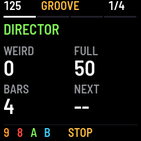

# Live7 performer interface

Live7 starts on LIVE: one performance surface with latched sections. Select a
section, release its button, then use the knobs and musical keys. No pagination.
All LIVE display text is at least 20 px: labels/status 20, heading 24, values 36.
The detailed legacy editor keeps its original layout and fonts.

## Start playing

1. On 303 A, press OCT+ for a phrase, then PLAY.
2. Tap ARP to select Director. Tap ARP again to coordinate B and the drum kit.
3. First four black keys select 909, 808, 303 A and 303 B. Hold SEL to link parts.
4. Tap EDIT for the selected instrument, LFO for Mixer, FX for momentary effects,
   ENV for Automation, or ARP for Director. These selections latch.

Key numbers below count white or black keys separately, from the left.

## Instrument

The four 303 knobs control cutoff, resonance, envelope modulation and decay.
Tap EDIT again for accent, waveform, drive and drive type; again returns to the
native controls. Independent patches and levels remain independent.

The first six white keys on a 303 apply small relative sound macros: Dry,
Squelch, Bite, Dub, Thin and Wide. Changes are bounded by each control's range.
They can operate on both selected 303s. Manual note playing remains in SEQ.

On drums, white keys select instruments; knobs control tuning, character,
decay and drive where supported. EDIT selects instrument level/pan/reverb/delay.
EDIT + PRESETS changes drum distortion type. PRESETS normally selects a drum
instrument or the focused 303 waveform.

## Mixer

Tap LFO for Mixer Level. Further LFO taps cycle Level, Pan, Reverb and Delay,
then wrap to Level. SELECT cycles these views in either direction. HOME + SELECT
changes tempo in Mixer; SELECT elsewhere in LIVE remains tempo.

Each view contains four vertical sliders, left-to-right: K1=909, K2=808,
K3=303 A, K4=303 B. Pan has a center mark. M indicates a muted part.
Black keys 1–4 directly toggle parts; white keys 1–11 toggle instruments in the
focused kit. PRESETS switches that kit between 909 and 808.

Hold REC and press a black or white key for solo. Repeat to clear; REC tap while
soloing restores the prior mix. HOME + SEL restores the mix captured before the
first manual mute. Manual mutes have priority over Director decisions.

Per-drum instrument pan/sends are available on its EDIT extra controls; select
that drum with a white key first. Part pan/sends are the Mixer cycles above.

## Automation

Tap ENV once. Knobs select target control, depth, cycle length and shape.
Cycle lengths: 1, 2, 4 or 8 bars. The target is one of the selected instrument's
four native sound controls. Drum parameters without a numeric control are ignored.

| White keys | Presets |
| --- | --- |
| 1–3 | Modulate: shallow / medium / deep |
| 4–6 | Growing saw: shallow / medium / deep |
| 7–9 | Falling saw: shallow / medium / deep |
| 10 / 12–16 | Stop all preset automation and return to manual values |
| 11 | Run the current custom shape/depth/length |

Presets capture the control's current value. K2 selects depth 0–127 and updates
an active gesture without shifting its center or phase. The three key shortcuts
choose 16, 32 and 48. Depth scales proportionally to the target range, then clips
at its limits: center 5, depth 10 on a 0–127 target produces 0–15. Depth 0 holds
the center. White key 11 runs any custom depth.
The modulation triangle moves around the captured value; growing/falling saws
move above/below it and repeat. The manual project setting is retained.

Automation joins the current musical phase: engage a four-bar grow in bar 3,
and it joins midway through that cycle, resetting at the end of bar 4. It does
not begin a new four-bar countdown. A new section establishes a new origin.
Extending a section preserves its current position and postpones the next one.

Up to eight parameter gestures can run at once. Turning an automated sound knob
takes over from its current audible value and cancels that gesture. Stopping
transport returns gestures to manual settings. Preset automation is session-only.
The shared bar reference is the 909's normal 16-step, sixteenth-note pattern;
keep that reference and legacy song/chaining off for this performance workflow.

## Director and section length

Tap ARP for Director. Knobs 1/2 are drum Weird/Full; knob 3 changes the current
segment length; knob 4 queues the next section. Musical keys provide direct access:

| White key | Action |
| --- | --- |
| 1–7 | Queue INTRO, GROOVE, BUILD, BREAK, BRIDGE, DROP, OUTRO |
| 8 / 9 | Shrink / extend the current segment by one bar |
| 10 | Coordinate B and drums around the established A phrase |

Tap ARP again while Director is selected for the same coordination action, or
to cancel a pending coordination plan. Choosing an already pending section
cancels that section choice; another choice replaces it.

Segments start at four bars and can be adjusted from the current bar through
32 bars. They keep looping until a section is queued. An extra break bar moves
the drop's downbeat later; shrinking moves it earlier without cutting the
current bar. The new section starts at bar 1 with a fresh automation origin.

Initial arrangement behaviors preserve the actual phrases and sound settings:
INTRO/OUTRO favor A, kick and hats; BREAK removes kicks and A; BRIDGE leaves
space for B; GROOVE permits the ensemble; BUILD raises drum intensity and adds
303 accents in its final bar; DROP accents the first bar's kicks. OUTRO reduces
drum intensity. Explicit performer mutes still win. These are initial section
policies, not a complete autonomous composition system.

The phrase coordinator keeps A and prepares a related B response and groove.
It needs nonempty A, forward 16-step 303s at sixteenth-note rate, automatic
mutation off, a normal 909 clock pattern, and no legacy song/chaining.

## Momentary FX

Tap FX once. Hold a white key; release it to return to the live signal.

| White key | Gesture |
| --- | --- |
| 1 / 2 | Low-pass / high-pass DJ filter |
| 3 / 4 | Kick pump / drive |
| 5 / 6 | Tape stop / chopper |
| 7 / 8 / 9 | Captured audio repeat at 1/8 / 1/16 / 1/32 |

One momentary effect is active at a time. Changing section/target or turning a
knob releases it. FX knobs remain master filter, pump, delay feedback and reverb
return level. The gestures currently target the master mix; per-target repeat
and drum-only DJ filtering are not yet provided.

Repeats capture the real stereo sound after the master processing. Audio capture
holds 16384 frames (about 371 ms at 44.1 kHz); very slow repeat lengths are capped
to this available history. Capture preserves approximately +/-2 signal units;
master output limiting still applies. Entry/release and loop seams are smoothed.
Tape stop slows to zero over 400 ms, with a fade over its final 80 ms. Chopper
repeats a complete open/closed cycle every sixteenth note while held.

To fit the capture ring without consuming the reserve, 32768 samples were
reassigned from delay memory. The delay buffer is now 55432 samples (about
1.26 seconds instead of 2 seconds); longer delay requests clamp to available
memory. Shared delay/reverb and their natural tails remain independent of the
short performance capture. Breakbeat playback remains disabled.

## Musical memory and saving

OCT+ makes new material; OCT- develops 303s or varies drums. ENV + OCT+ captures
LIKE; LFO + OCT- RETURN restores selected captures. REC tap is one-level musical
undo; REC + OCT+ redo. Undo preserves your later sound/mix changes. New musical
actions replace the previous history entry.

SAVE saves the project. LIKE captures, musical undo, mutes, section position and
preset automation are session-only. Hold SEL and tap SEQ for classic editing,
GLO for settings, or HOME for classic patterns. Plain HOME returns to LIVE;
in LIVE it selects native instrument controls. HOME + EDIT is an alternative
return gesture.

## Validation and limits

This build has not been tested. See [Live7 build notes](PERFORMANCE-UX-NEXT.md).
Hardware timing, stack use, physical controls and device installation/recovery
remain unverified. A browser emulator does not qualify the hardware build.
