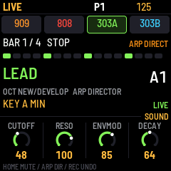
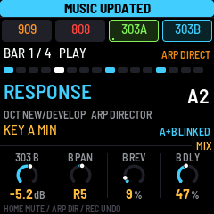
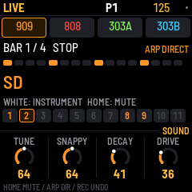

# Live5 performer interface

Live5 starts on **LIVE**, a single performance screen. It shows colored target
selection/activity, four-bar phase, sixteenth-note progress, Director queue status,
the selected instrument/role, and the four current knob values. This is the
musical interface; the old PERF screen remains CPU diagnostics.

## Start playing

1. Boot on 303 A. Press OCT+ for a phrase, then PLAY.
2. Tap ARP to ask the Director to coordinate B and the drum kit. While playing,
   it waits for the next four-bar boundary. Tap ARP again to cancel a pending plan.
3. The first four black keys select 909, 808, 303 A and 303 B. Select a drum kit
   and press OCT+ to generate it directly, or use the Director from a 303 for 909.

Director constraints remain: nonempty A, forward 16-step/sixteenth-note parts,
automatic mutation off, no legacy song or pattern chain. The screen says
DIRECTOR NOT READY if those conditions are not met. It does not invent sections
or claim an autonomous song arranger has been implemented.

## Direct controls

All key numbers below count white or black keys separately, from the left.
Hold a modifier, press the target/key or turn a knob, then release the modifier.

| Control | Behavior in LIVE |
| --- | --- |
| Black 1–4 / ALGORITHM | Select 909 / 808 / 303 A / 303 B. Selection never mutes or generates. |
| SEL + black 1–4 | Toggle a target in the selection; at least one remains. The last selected member becomes knob focus. |
| White 1–11 on drums / PRESETS | Select the drum instrument. White keys audition it while stopped; during playback selection is silent. |
| White keys on a 303 | Play temporary notes; selecting another target or leaving LIVE releases them. Black keys retain their selection role. |
| SELECT | Tempo. It never pages the LIVE screen. |
| PRESETS on a 303 | Focused synth's waveform. Held EDIT also displays that value. |
| Knobs, no modifier: 303 | Cutoff, resonance, envelope modulation, decay. |
| Knobs, no modifier: drums | Tuning, snappy/attack/tone (instrument-dependent), decay, drive. Missing native controls remain empty. |
| EDIT + knobs: 303 | Accent, waveform, drive amount, drive type. Choose Soft/RAT to enable the 303 drive. |
| EDIT + knobs: drums | Instrument level, pan, reverb send, delay send. |
| EDIT + PRESETS on drums | Instrument distortion type. |
| LFO + knobs | Selected part level, pan, reverb send, delay send. |
| SEL + LFO + knobs | Drum-instrument level/pan/sends; on a 303, its part level/pan/sends. |
| ENV + knobs: 303 | Density, accent chance, slide chance, octave range. These configure the generator; OCT+ or OCT- applies a musical action. |
| ENV + knobs: drums | Weird, Full, swing, accent velocity. Weird/Full regenerate through the existing mailbox. |
| FX + knobs | Master DJ filter, kick pump, delay feedback, reverb return level. These are explicitly master/shared-return controls. |
| PLAY | Start/stop. |
| SAVE | Save project. Runtime captures, musical undo and manual mutes are not newly made persistent. |

For several selected 303s, sound controls move each selected instrument by the
same relative delta, preserving differences until a parameter reaches a bound.
Native/extra/composition controls only affect selected targets in the focused
family (303s or drums). Part mixing affects all selected targets. Master controls
apply once. Drum Weird/Full knobs affect the focused kit because that generator
uses one outstanding request; OCT actions can compose both selected kits atomically.
Encoder changes are relative, so changing target/layer cannot jump to an absolute
knob position. Releasing a layer returns to native sound controls immediately.

## Mute, solo and restore

| Gesture | Action |
| --- | --- |
| HOME + black 1–4 | Toggle part mute. |
| HOME + white 1–11, drums focused | Toggle that drum instrument. Remains available with FX held. |
| REC + black 1–4 | Solo that part. Repeat the same solo to clear it. |
| REC + white 1–11, drums focused | Solo that drum instrument. |
| REC tap while soloing | Clear solo and restore the pre-solo mix. |
| HOME + SEL | Restore the mix captured before the first manual mute gesture; with no capture, explicitly unmute all. |

Solo retains existing explicit manual mutes rather than silently unmuting their
targets. A new solo replaces the old solo. A manual mute clears solo first, then
applies the new manual choice. Leaving LIVE restores a temporary solo. Initial
drum generation still follows live4's kick/hats starting mix and manual priority.

## Musical operations

| Gesture | Action |
| --- | --- |
| OCT+ | New material for selected targets. |
| OCT- | Develop selected 303 motifs; reseed selected drum grooves at their current coordinates. Straight standards intentionally remain recognizable. |
| ENV + OCT+ | LIKE each selected member (independent per-member captures). |
| LFO + OCT- | RETURN all selected captures in one publication; refuses the action if any selected capture is missing. |
| REC tap | One-level musical undo, preserving later sound and mute changes. While a Director plan is queued, cancels it instead. |
| REC + OCT+ / HOME + PLAY | Musical redo. |
| HOME + REC | Alias for musical undo. |
| ARP | Director request; again cancels a pending Director plan. |

New/develop/RETURN prepare fixed snapshots on main and apply them together at an
audio-block boundary. A changed source or pattern switch cancels a stale plan.
The one-level musical history covers these actions, drum-coordinate regeneration,
and an applied Director ensemble. It contains notes/hits and generator settings,
not patches, levels, sends, automation or mutes. New musical actions replace this
one-level history. It resets on project initialization/reboot. The legacy editor
retains its separate, broader undo/redo system.

LIKE requests for several members use the existing one-slot capture service in
sequence; wait for their acknowledgments before another composition request.
RETURN is atomic across the selected members. The system refuses overlapping
composition requests; it never waits for them in audio. Automatic 303 mutation
must be off for these performer composition operations.

## Momentary effects

Hold **FX + white 1 / 2 / 3 / 4** for **master low-pass / high-pass / pump /
drive** respectively. The screen names the master target and active gesture.
The underlying project pots are retained; release restores the latest project
values. Releasing FX, changing selection or leaving LIVE also restores the effect.
A knob turn ends a temporary effect before applying the manual change.

One momentary effect is active at a time; pressing another replaces it. Releasing
the current effect returns to the live settings rather than resuming an older
held gesture. Master filter restoration includes its exact mode, cutoff and
resonance, preserving a custom underlying filter configuration.

**Not implemented here:** per-drum DJ filtering, per-target audio repeat/looper,
chopper, tape stop and section/QUEUE behaviors. The UI does not provide fake
controls for these missing DSP/Director features. Per-303 drive and sends are
independent; the momentary gestures above target the master only.

## Editor and configuration access

SEQ opens detailed step editing. HOME opens the old pattern/song workspace.
GLO opens configuration. **Hold HOME and tap EDIT** to return directly to LIVE
from these screens. Entering LIVE clears recording and legacy song playback,
releases keyboard-held notes and restores a temporary solo/effect on exit.
Held EDIT, ENV, LFO and FX remain temporary layers in LIVE; tapping them does
not open the old pages. REC is musical undo/solo here; recording remains in SEQ.

In the browser, Shift-click a modifier to latch it, use the other control, then
click the modifier again to release it. Refresh the emulator to load live5.

## Validation and limits

Base: `6557e22` / live4. Same FM-1, JieLi clang 4.0.1 pi32v2 r3, AC79 SDK,
44.1 kHz, 512-frame I2S half-buffer and 256-frame render calls. Build:
`tools/build-fm1-wsl.sh --release 1.2.1-live5`; suite: `tools/test-fm1-wsl.sh`.

Main prepares snapshots; render validates current pattern IDs and bounded FNV
fingerprints before copying fixed state. Four 512-byte snapshots and 16 hash bytes
add 2064 bytes to the pool. A complete musical commit checks at most 488 source
bytes, writes up to 488 pattern bytes plus drum configs, and performs bounded
512-byte history copies. Director publication also captures its fixed before/after
state. Source/disassembly review includes the existing byte-loop `memcpy`; no
allocation, storage, logging, waits, double math or new DSP loop is introduced.
Hash change detection has the normal possibility of collision, not a cryptographic
guarantee. No audio depends on UI/render completion outside its existing schedule.

| Compliance category | Status / evidence |
| --- | --- |
| Target / build / ABI | PASS: release build, matched SDK/loader and all existing manifest/register/size checks retained. Final sizes recorded below. |
| Audio hot path / numerics | PASS for source/target structural checks: bounded snapshot copies and fingerprints only; generation stays on main. Existing freestanding memcpy is bounded by constant snapshot sizes. No soft-double routines; RAM flash code remains call-free. Device timing remains UNVERIFIED. |
| Execution ownership / synchronization | PASS for source/host scope: main owns staging, renderer consumes after mailbox publication; one command pending, no waits. Existing main/renderer/optional 808 worker arrangement retained. |
| Memory / storage / I/O | PASS for static budget and storage tests: existing pool reserve retained, no additional audio/display buffers, no project/schema/flash partition changes. Peak stack on hardware UNVERIFIED. |
| Dependencies / licenses | PASS: no dependencies added; existing fonts/DSP resources and GPL notices retained. Screen uses existing supported glyphs and canvas. |
| Compatibility / package / recovery | PASS for host/package scope: old editor fixtures, storage/migrations, backup/update tests. Native tests explicitly opt into the old editor where required; normal hardware/web boot uses LIVE. Device install/recovery UNVERIFIED. |
| Host functional validation | Final results below. New scenarios cover multi-selection, linked relative knobs, drum sound/mix, mute/solo/restore, multi-capture RETURN, musical undo after sound/mute edits, Director undo, and effect release on key/modifier/selection/mode changes. Host screen images visually inspected. |
| Hardware real-time validation | UNVERIFIED. Test dense two-303/two-kit/FX playback with repeated musical commits and Director transitions; measure render maxima, underruns, input latency, stack high-water and sustained use. Check physical modifier reach/release on FM-1. No device was flashed. |

Three external engine comparisons (9W9/8W8/schwung-303), the optional TB3PO
reference and browser speech assets remain unavailable. Eight legacy breakbeat
performance scenarios remain retired. Existing unrelated signedness warnings
remain in the native build. Host CPU percentages and browser timing are not FM-1
real-time qualifications.

Final target image: **382796 bytes**; ordinary RAM region **96340/98304 bytes**;
pool **331664/344064 bytes**. The pool has 12400 bytes remaining, preserving the
8192-byte reserve and leaving 4208 bytes for further pool allocations. No extra
display or audio buffer is used by the interface.

All **45 supported application scenarios** pass, including the four new
performer scenarios. Legacy scenarios explicitly select the editor in the native
test harness; hardware and browser boot into LIVE. Available generator/DSP golden,
storage/migration/backup, update and browser tests pass. The full runner exits 1
because the three external engine comparison checkouts are absent. Browser/host
comparison: 168021 samples, peak 0.261, max difference 3.05e-5, screen/lights match.
Uploaded break loops have no effect on a real generated performer phrase (both
browser renders peak 0.156 and have identical signatures). Rendered boot, linked
mix, drum and momentary-FX screens were visually checked; captured screenshots
wait for a full UI frame rather than reading an old framebuffer.

Package SHA-256:
`6bc03688bee7e2f6ead1db40b7d79dfd050852207305ac195d0e8f8d5c06a1c0`.
